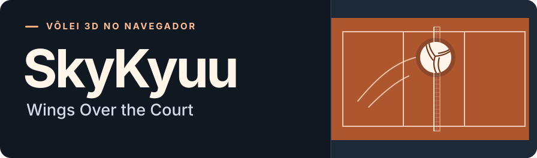
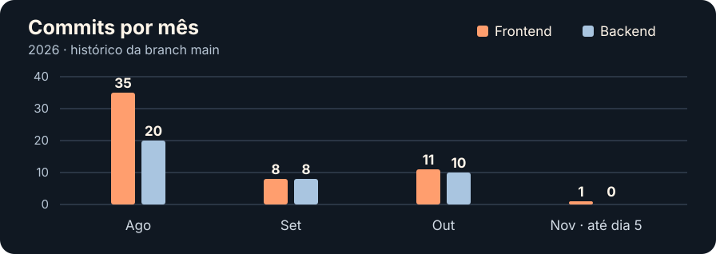

## Dentro da quadra

**SkyKyuu: Wings Over the Court** é um jogo 3D de vôlei para navegador em desenvolvimento. O protótipo já reúne uma quadra coberta, movimentação e salto, física da bola e rebatidas em que o momento do contato e a direção do comando influenciam a jogada.

No navegador, a cena roda com Babylon.js e tem controles locais por teclado e gamepad. No servidor, o núcleo de simulação em Java já trata a trajetória da bola e o contato com o jogador. Para o multiplayer online, a arquitetura prevista deixa o servidor responsável pelas regras, pelo estado da partida e pela validação das jogadas.

No futuro, o SkyKyuu também pode ganhar uma versão em aplicativo.

### Onde o jogo toma forma

| Repositório | O que você encontra | Linguagens e tecnologias |
| --- | --- | --- |
| [Frontend](https://github.com/SkyKyuu/skykyuu-frontend) | Quadra 3D, câmeras, controles e protótipo jogável |          |
| [Backend](https://github.com/SkyKyuu/skykyuu-backend) | Núcleo de simulação e serviço do jogo |     |
| [Especificações](https://github.com/SkyKyuu/skykyuu-specs) | Repositório reservado para a documentação, ainda vazio em 5 de novembro de 2026 | — |

## Diário de quadra

Retrato de 5 de novembro de 2026. A contagem inclui merges das branches principais e agrupa os commits pelo mês registrado no Git. Históricos do <a href="https://github.com/SkyKyuu/skykyuu-frontend/commits/main/">frontend</a> e do <a href="https://github.com/SkyKyuu/skykyuu-backend/commits/main/">backend</a>.

### Quem constrói o jogo

**[Eduardo Tamborelli Ferreira Lino](https://github.com/Eduardo-Tamborelli-Ferreira-lino)** · Criador e desenvolvedor full stack
